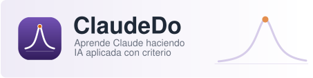

{fig-alt="ClaudeDo: aprende Claude haciendo. IA aplicada con criterio." width="100%"}

Curso de IA aplicada al trabajo profesional, la programación y la investigación, para estudiantes, profesorado, ingeniería y personas usuarias avanzadas. Funciona en **macOS** (Terminal, Zsh) y **Windows** (PowerShell); Claude Code se verifica contra su documentación oficial y cada unidad muestra la versión con la que se comprobó. Puedes seguirlo de principio a fin o entrar directamente en una unidad si cumples sus prerrequisitos.

## Itinerarios

| Itinerario | Para qué | Unidades |
|---|---|---|
| **Fundamental** | Entender la IA y usar Claude con criterio en el trabajo diario | C0 · C1 |
| **Aplicado** | Terminal, Git, Claude Code, programación y análisis de datos | C2 · C3 · C4 · C5 · C6 |
| **Avanzado** | Personalizar, automatizar, integrar la API y proyectos integradores | C7 · C8 · C9 |

## Unidades

| Id | Unidad | Nivel | Estado del texto |
|---|---|---|---|
| C0 | [Fluidez en IA, fundamentos e historia](c0-fluidez/index.qmd) | Básico | Redactada y auditada |
| C1 | [Claude y el ecosistema Anthropic](c1-claude-web/index.qmd) | Básico | Redactada; en revisión |
| C2 | [Preparación del entorno y terminal](c2-terminal/index.qmd) | Básico | Redactada; en revisión |
| C3 | [Git, GitHub y worktrees](c3-git/index.qmd) | Intermedio | Redactada; en revisión |
| C4 | [Claude Code: fundamentos y trabajo cotidiano](c4-claude-code/index.qmd) | Intermedio | Redactada; en revisión |
| C5 | [Programación profesional asistida por IA](c5-programar/index.qmd) | Intermedio | Redactada; en revisión |
| C6 | [Excel, datos, Quarto e informes](c6-informes/index.qmd) | Intermedio | Redactada; en revisión |
| C7 | [Personalización: CLAUDE.md, skills, hooks y MCP](c7-extender/index.qmd) | Avanzado | Redactada; en revisión |
| C8 | [Automatización, agentes y entornos avanzados](c8-automatizar/index.qmd) | Avanzado | Redactada; en revisión |
| C9 | [API, investigación y proyectos integradores](c9-api/index.qmd) *(opcional)* | Avanzado | Redactada; en revisión |

**Niveles.** *Básico*: sin experiencia previa en terminal ni programación. *Intermedio*: usas la terminal y Git con soltura. *Avanzado*: dominas el flujo intermedio y quieres personalizarlo o automatizarlo.

## Conceptos y herramientas

El curso separa dos tipos de contenido. Los **conceptos** (qué es un modelo de
lenguaje, sus límites, cómo delegar y verificar, privacidad, integridad académica,
control de versiones, pruebas como contrato) cambian poco y se explican sin
depender de una herramienta concreta. Las **instrucciones de herramienta**
(comandos, opciones, menús y configuración de Claude Code o de la API) cambian
con cada versión: por eso cada unidad indica bajo su título con qué versión se
comprobó, y la [hoja de consulta](hoja-consulta.qmd) se genera desde un registro
de comandos verificados.

## Cómo se indica lo que cuesta y lo que está comprobado

Cada práctica lleva una etiqueta: [Local gratuita]{.ejec .ejec-local} (solo tu ordenador), [Simulación]{.ejec .ejec-sim} (en el navegador), [Requiere cuenta]{.ejec .ejec-cuenta} o [Puede generar coste]{.ejec .ejec-coste} (con la alternativa gratuita cuando existe). Bajo el título de cada unidad verás su versión, la fecha de edición, si se ha comprobado técnicamente y la versión de Claude Code de la documentación consultada. Una unidad «pendiente de revisión» puede contener ejemplos aún sin ejecutar.

## Recursos

- [Hoja de consulta de comandos](hoja-consulta.qmd): terminal, Git, `claude` y sus comandos de sesión, generada desde el registro verificado (<a href="descargas/hoja-consulta.txt" download>descargar en texto (Markdown)</a>).

## Sitios hermanos

ClaudeDo nació como la vía C de [Resonancia](https://me1catrr.github.io/resonancia/),
el curso de vibraciones, señales y monitorización estructural de la Universidad de
Córdoba, y comparte su identidad con [JuliaDo](https://me1catrr.github.io/juliado/),
que enseña programación y computación científica con Julia.

ClaudeDo es un proyecto docente independiente, sin afiliación con Anthropic.
